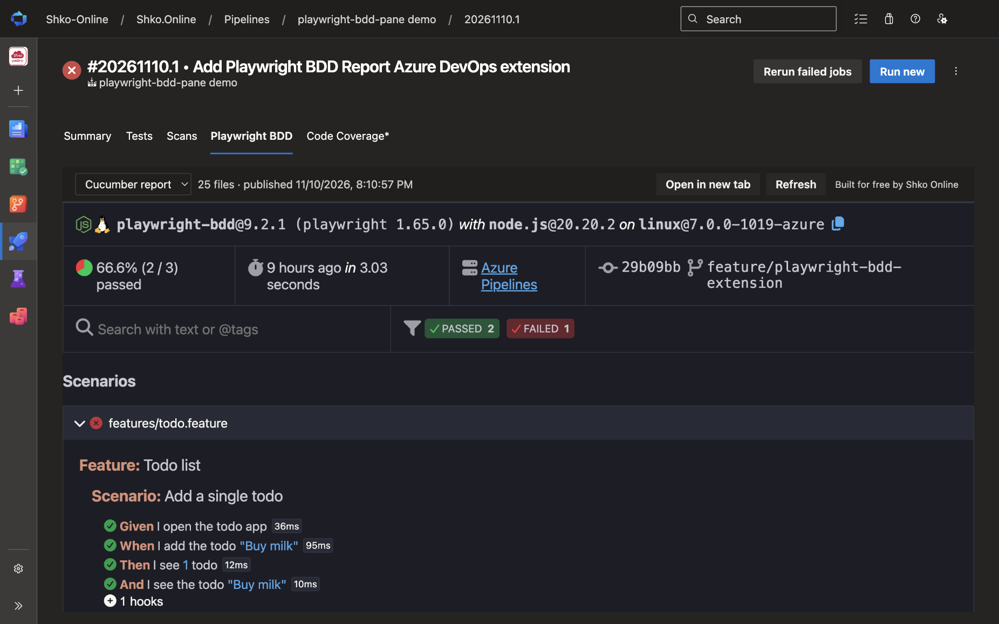
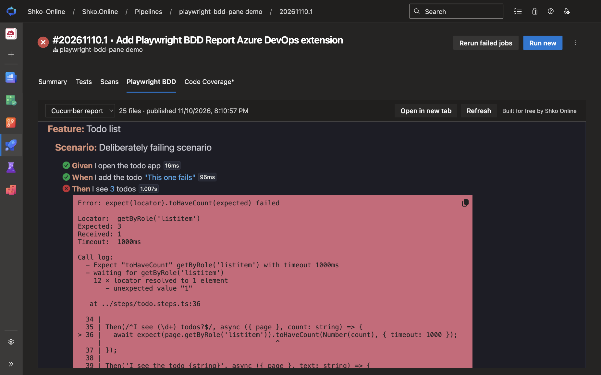
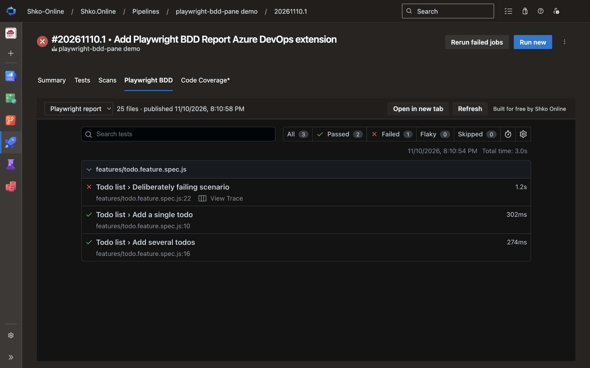
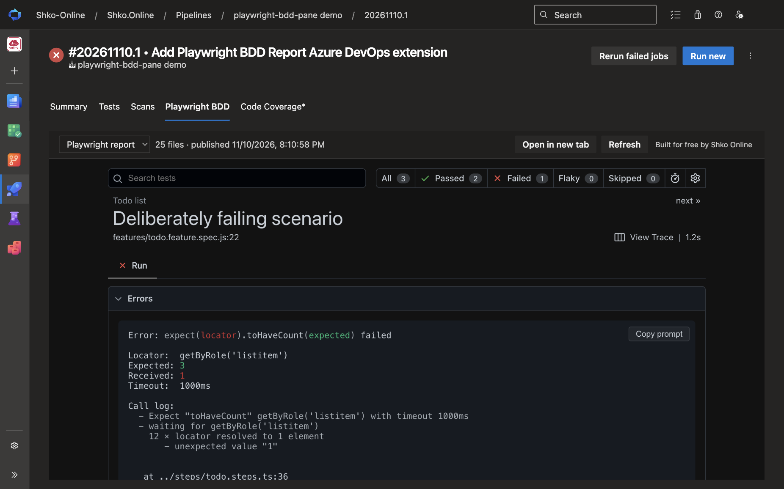
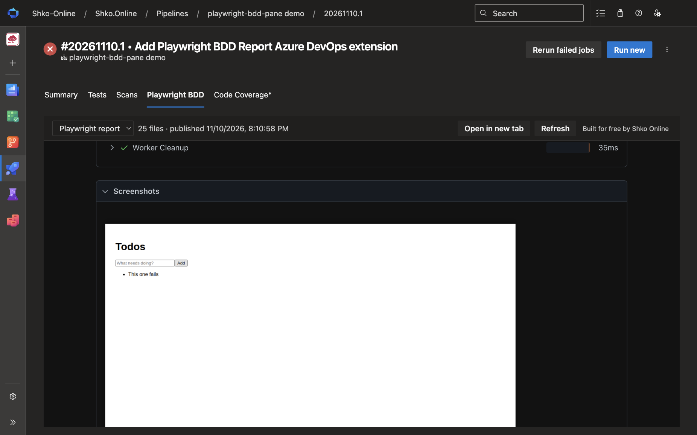
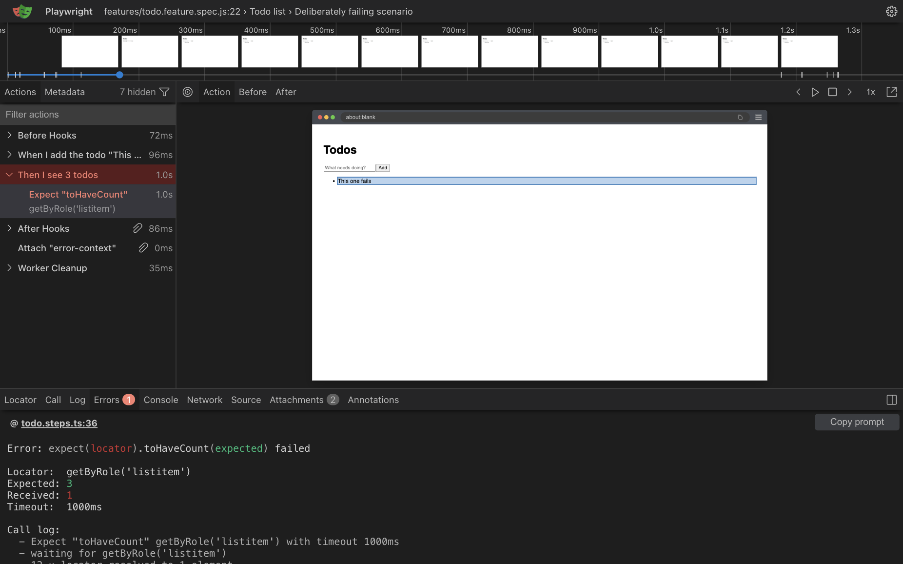

# Playwright BDD Report: Azure DevOps extension

Publish [playwright-bdd](https://vitalets.github.io/playwright-bdd/) HTML reports from Azure Pipelines and review them in a **Playwright BDD** tab on the run page. Reviewers don't need to download anything. User-facing docs live in [overview.md](overview.md), which is also the Marketplace page.

**[Try the interactive demo](https://shko-online.github.io/playwright-bdd-pane/iframe.html?id=demo-pipeline-run--run-20261110-1&viewMode=story)**: pipeline run #20261110.1 of the sample project, recreated in [Storybook](https://shko-online.github.io/playwright-bdd-pane/) with the real **Playwright BDD** tab. Nothing to install.

## Screenshots

These come from a run of the [sample project](samples/demo), which has one deliberately failing scenario. Its full pipeline is [samples/demo/azure-pipelines.yml](samples/demo/azure-pipelines.yml). In the snippets below, the sample's `$(demoDir)/` path prefix is left out.

### Cucumber report

Publish the folder written by `cucumberReporter('html')`:

```yaml
- task: PublishPlaywrightBddReport@1
  displayName: Publish Cucumber report
  condition: succeededOrFailed()   # publish when tests fail too
  inputs:
    reportDir: cucumber-report
    reportName: Cucumber report
```

The run page gets a **Playwright BDD** tab with the report: the summary, the run's commit and branch, and every feature and scenario.



Filter by status to go straight to failures. Each failed step shows its error, the call log, and the source line.



### Playwright report

Playwright's own HTML report can be published as well, with a second task:

```yaml
- task: PublishPlaywrightBddReport@1
  displayName: Publish Playwright report
  condition: succeededOrFailed()
  inputs:
    reportDir: playwright-report
    reportName: Playwright report
```

When a run has more than one report, the picker in the tab's toolbar switches between them.



Test details work as they do locally: errors, test steps, and attachments.





**View Trace** opens the test's trace in the Playwright Trace Viewer, inside the tab. The viewer ships with the extension, so the trace never leaves the browser and no outside service is involved. **Back to report** returns to the report where you left it, and **Open trace in new tab** gives the trace a full browser tab.



## How it works

```
 pipeline agent                                   browser (run page → "Playwright BDD" tab)
┌──────────────────────────────┐                 ┌───────────────────────────────────────────────┐
│ PublishPlaywrightBddReport@1 │                 │ tab.html (extension iframe)                   │
│  • zip report folder         │  build          │  • list attachments of type                   │
│  • + .pbdd/manifest.json     │  attachment     │    "playwright-bdd-report" (REST, vso.build)  │
│  • ##vso[task.addattachment] │ ──────────────▶ │  • download + unzip in memory (JSZip)         │
└──────────────────────────────┘                 │  • ReportHost: archive path → blob: URL       │
                                                 │  • <iframe src=blob:…index.html>              │
                                                 │      └ shim rewrites relative URLs to blobs   │
                                                 │  • "View trace" → trace/index.html (bundled   │
                                                 │      Trace Viewer), Blob via postMessage      │
                                                 └───────────────────────────────────────────────┘
```

Report pages are served from `blob:` URLs, which can't act as a base for relative URLs. So a small shim ([src/viewer/shim.ts](src/viewer/shim.ts)) is injected at the top of every HTML page. It patches `fetch`, XHR, `URL`, `window.open`, the `src`/`href` setters, and adds a `MutationObserver`, so references like `data/abc.png` resolve to blob URLs served by [ReportHost](src/viewer/host.ts). The trace viewer bundled inside a report needs a service worker and can't run from a blob. Instead, the extension ships the Playwright Trace Viewer (`web/trace/`), copied as published from the `playwright-core` npm package by [scripts/trace-viewer.mjs](scripts/trace-viewer.mjs). Trace links open it in a panel over the report ([src/viewer/trace.ts](src/viewer/trace.ts)), and the trace is handed over with the viewer's `postMessage` load API.

| Path | What |
| --- | --- |
| [tasks/PublishPlaywrightBddReport](tasks/PublishPlaywrightBddReport) | Pipeline task (`task.json`, `src/index.ts`) |
| [src/tab](src/tab) | Build results tab: SDK wiring, attachment source, styles |
| [src/viewer](src/viewer) | Archive loading, `ReportHost`, shim, and viewer UI (shared with the dev harness) |
| [src/shared/constants.ts](src/shared/constants.ts) | Attachment type and manifest format shared by the task and the tab |
| [src/dev](src/dev) | Local harness that runs the viewer without Azure DevOps |
| [stories](stories) | Storybook: the demo of run #20261110.1 (its real report zips in [stories/assets](stories/assets)) and the viewer's states |
| [samples/demo](samples/demo) | playwright-bdd sample project and an example `azure-pipelines.yml` |
| [vss-extension.json](vss-extension.json) | Extension manifest |

## Develop

```sh
npm install
(cd tasks/PublishPlaywrightBddReport && npm install)

# sample reports (the sample includes one deliberately failing scenario)
(cd samples/demo && npm install && npx playwright install chromium && npm test)

npm run fixtures   # runs the real task against the sample reports → .fixtures/*.zip
npm run dev        # http://localhost:5173/host.html  (viewer in a cross-origin sandboxed iframe)
                   # http://localhost:5173/dev.html   (viewer top-level, handy for devtools)
npm run storybook  # http://localhost:6006  (demo run page and the viewer's states)
npm run typecheck
```

To update the Playwright Trace Viewer, change the version of `playwright-core` in [package.json](package.json).

Every push to `main` publishes the Storybook to GitHub Pages ([.github/workflows/storybook.yml](.github/workflows/storybook.yml)).

## Releases

Releases are automatic. Every push to `main` runs [.github/workflows/release.yml](.github/workflows/release.yml), where [semantic-release](https://semantic-release.gitbook.io/) picks the next version from the commit messages since the last `v*` tag:

| Commit message | Release |
| --- | --- |
| `fix: …` | patch (1.2.**3**) |
| `feat: …` | minor (1.**3**.0) |
| `feat!: …`, or a `BREAKING CHANGE:` footer | major (**2**.0.0) |
| `docs:`, `chore:`, `ci:`, `refactor:`, `test:`, `build:` … | no release |

For a release, the workflow then:

1. checks that Marketplace Trusted Publishing works, before anything is tagged;
2. packages the `.vsix`, stamping the version into the manifest and `task.json`;
3. publishes it to the Visual Studio Marketplace;
4. creates the `vX.Y.Z` tag and a GitHub Release with notes and the `.vsix` attached.

Versions live only in tags. The `0.0.0` in [vss-extension.json](vss-extension.json) and [task.json](tasks/PublishPlaywrightBddReport/task.json) is a placeholder, and nothing is committed back to `main`.

The task version always matches the extension version. A major release therefore moves the task to a new major, and pipelines must change `PublishPlaywrightBddReport@1` to `@2`. Use `!` / `BREAKING CHANGE` only for changes that really break existing pipelines.

### Marketplace authentication

Publishing uses [Trusted Publishing](https://learn.microsoft.com/azure/devops/extend/publish/overview#publish-with-oidc-trusted-publishing), so there is no PAT or secret. The workflow exchanges its GitHub OIDC token for a credential that lasts 15 minutes ([scripts/release/marketplace.mjs](scripts/release/marketplace.mjs)). This is the same exchange `vsce publish --oidc` makes.

It requires a policy on the `shko-online` publisher (Marketplace → publisher → **Trusted Publishing**):

| Field | Value |
| --- | --- |
| Repository owner | `Shko-Online` |
| Repository | `playwright-bdd-pane` |
| Workflow | `release.yml` |
| Environment | `marketplace` |

### Manual packaging

```sh
npm run package -- --version 1.2.3   # out/shko-online.playwright-bdd-pane-1.2.3.vsix (public)
npm run package:dev -- --version 1.2.3   # private "-dev" variant, for testing in one organization
```

## License

[MIT](LICENSE). The extension also ships the Playwright Trace Viewer from the [`playwright-core`](https://www.npmjs.com/package/playwright-core) npm package, unmodified. It is © Microsoft Corporation and licensed under the Apache License 2.0; its LICENSE and NOTICE are distributed with it in `web/trace/`.
