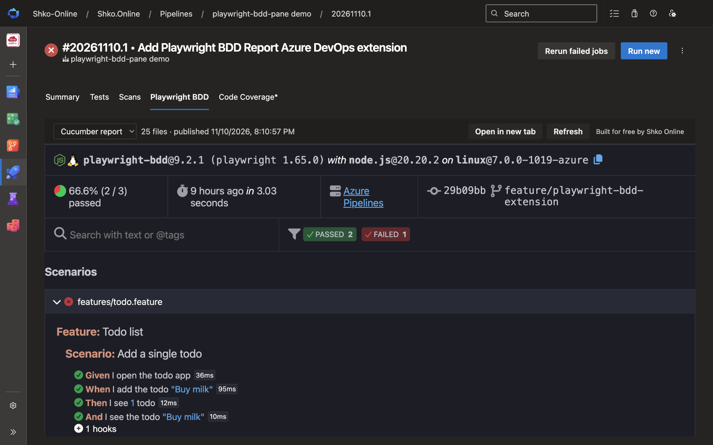
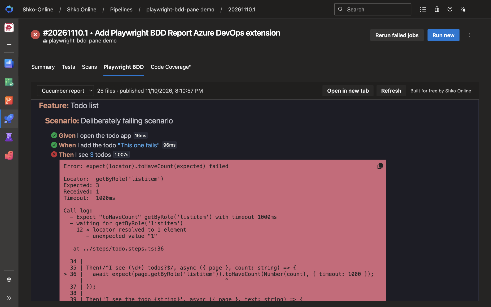
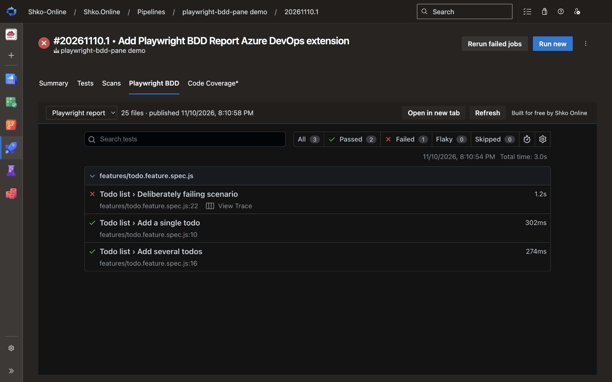
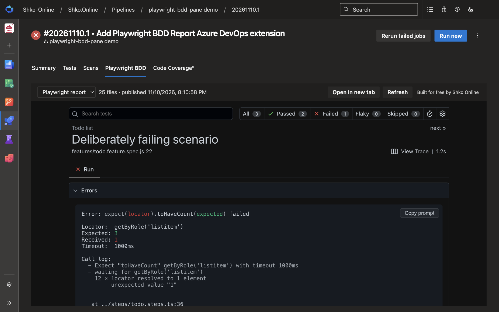
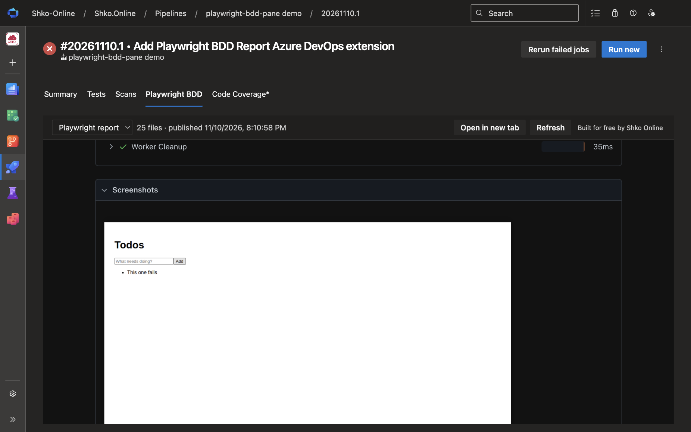
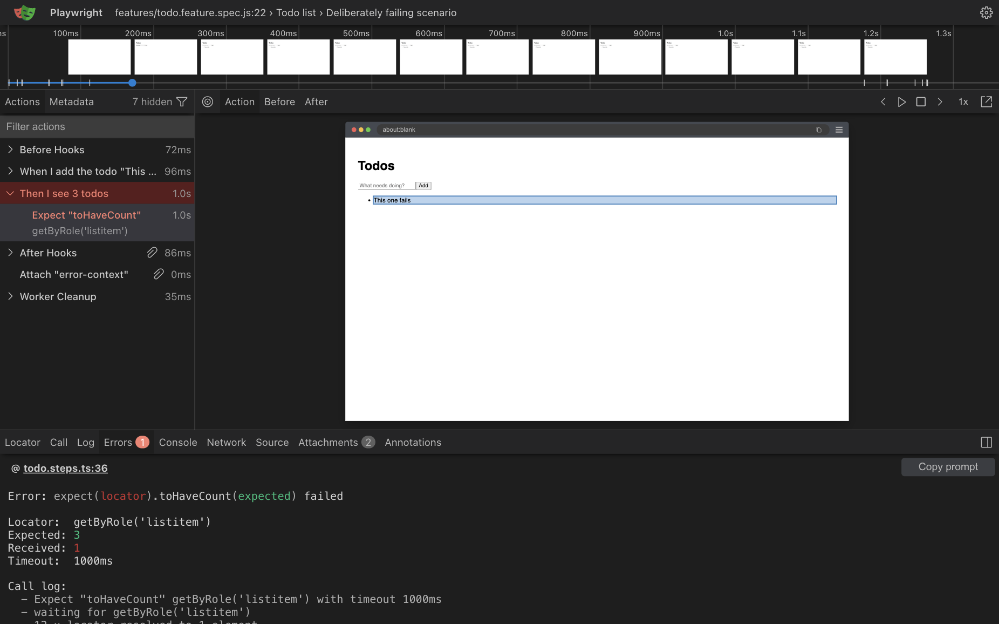

# Playwright BDD Report

Review [playwright-bdd](https://vitalets.github.io/playwright-bdd/) test reports right inside Azure Pipelines. Publish the report from your pipeline, open the run, and select the **Playwright BDD** tab. You don't have to download or unzip any artifacts.

**[Try it first in the interactive demo](https://shko-online.github.io/playwright-bdd-pane/iframe.html?id=demo-pipeline-run--run-20261110-1&viewMode=story)**: a recreated pipeline run with the real tab, no installation needed.

## What you get

- **A pipeline task** (`PublishPlaywrightBddReport@1`) that attaches your HTML report to the run.
- **A "Playwright BDD" tab** on the run page that renders the report: features, scenarios, steps, errors, and screenshots.
- **Traces in one click.** *View trace* opens the trace in the Playwright Trace Viewer, right inside the tab. The viewer ships with the extension: the trace stays in your browser, and nothing is saved to disk.
- Works with the **Cucumber HTML report** (`cucumberReporter('html')`) and with **Playwright's HTML report**. Publish both and switch between them in the tab.

## Screenshots

From a run of the [sample project](https://github.com/Shko-Online/playwright-bdd-pane/tree/main/samples/demo), which has one deliberately failing scenario.

**Cucumber report.** The run page gets a **Playwright BDD** tab with the summary, the run's commit and branch, and every feature and scenario.



Filter by status to go straight to failures. Each failed step shows its error, the call log, and the source line.



**Playwright report.** Publish Playwright's own HTML report with a second task, and switch between the reports with the picker in the tab's toolbar.



Test details work as they do locally: errors, test steps, and attachments.





**View Trace** opens the test's trace in the Playwright Trace Viewer, inside the tab. **Back to report** takes you back where you were.



## Get started

1. Configure the playwright-bdd HTML reporter in `playwright.config.ts`:

   ```ts
   import { defineConfig } from '@playwright/test';
   import { defineBddConfig, cucumberReporter } from 'playwright-bdd';

   const testDir = defineBddConfig({ features: 'features/*.feature', steps: 'steps/*.ts' });

   export default defineConfig({
     testDir,
     reporter: [cucumberReporter('html', { outputFile: 'cucumber-report/index.html', externalAttachments: true })],
     use: { screenshot: 'only-on-failure', trace: 'retain-on-failure' },
   });
   ```

2. Add the task after your test step:

   ```yaml
   - script: npx bddgen && npx playwright test
     displayName: Run tests

   - task: PublishPlaywrightBddReport@1
     condition: succeededOrFailed()   # publish the report when tests fail too
     inputs:
       reportDir: cucumber-report
   ```

3. Run the pipeline, open the run, and select the **Playwright BDD** tab.

To also publish Playwright's HTML report (`['html', { outputFolder: 'playwright-report' }]` in the reporters), add a second task:

```yaml
- task: PublishPlaywrightBddReport@1
  condition: succeededOrFailed()
  inputs:
    reportDir: playwright-report
    reportName: Playwright report
```

## Task inputs

| Input | Default | Description |
| --- | --- | --- |
| `reportDir` | `cucumber-report` | Folder that contains the report. Relative to `$(System.DefaultWorkingDirectory)`. |
| `entryFile` | `index.html` | Page to open first. |
| `reportName` | job name | Name in the tab's report picker. Give each report its own name if one job publishes several. |
| `ifMissing` | `warn` | `warn`, `error` or `ignore` when the report folder is missing. |

## Notes

- **Multiple jobs and reports.** Each published report appears in the tab's picker. Reports with the same name from different jobs (for example, matrix jobs) are labelled with their job name.
- **Runs in progress.** The tab checks for new reports every few seconds until the run completes.
- **Permissions.** The extension only asks for *Build (read)* to read the reports attached to a run.
- **`externalAttachments: true`** keeps the report small and fast to load. It is also required for *View trace* links in the Cucumber report.

## Privacy

The extension has no telemetry. Reports are downloaded from your Azure DevOps organization and unpacked in your browser. Traces open in the Playwright Trace Viewer that comes with the extension, so they never leave your browser either.

## Built for free by Shko Online

Playwright BDD Report is built and maintained for free by [Shko Online](https://shko.online/?utm_source=azure-devops&utm_medium=marketplace&utm_campaign=playwright-bdd-report), a Microsoft Business Applications consultancy in Tirana, Albania. We build Azure DevOps extensions, pipelines and test automation, and deliver Dynamics 365, Power Platform and Azure projects.

Need a feature, or help with your next project? [Book a consultation](https://shko.online/contact-us?utm_source=azure-devops&utm_medium=marketplace&utm_campaign=playwright-bdd-report) or write to sales@shko.online.
